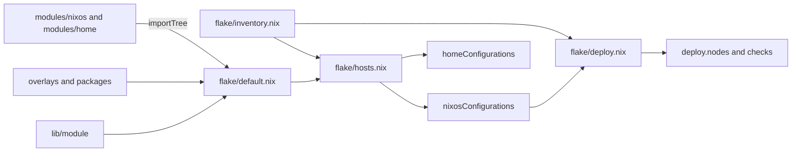

# Architecture

## Directory layout

```
.
├── flake.nix        # inputs; delegates the outputs to ./flake
├── flake/           # flake-parts modules and inventory
│   ├── default.nix  # core: lib, overlays, module import, host constructors
│   ├── inventory.nix# list of hosts, homes and deploy targets
│   ├── hosts.nix    # creates nixosConfigurations and homeConfigurations
│   ├── deploy.nix   # creates deploy.nodes and deploy-rs checks
│   ├── modules.nix  # exports nixosModules and homeManagerModules
│   ├── overlays.nix # exports overlays
│   └── packages.nix # exports packages and formatter
├── lib/module/      # helper functions, available as lib.awesome-flake
├── modules/nixos/   # NixOS modules
├── modules/home/    # Home Manager modules
├── systems/         # host configurations, sorted by architecture
├── homes/           # Home Manager configurations, sorted by architecture
├── overlays/        # nixpkgs overlays
├── packages/        # custom packages
├── secrets/         # files encrypted with sops
├── .sops.yaml       # recipients of the secrets
└── .forgejo/        # CI workflow
```

## From flake to host

`flake.nix` only defines the inputs. The outputs are built in `flake/` with [flake-parts](https://flake.parts). Supported systems are `x86_64-linux` and `aarch64-linux`.



The inventory `flake/inventory.nix` is the central list and contains:

- `flakeRoot`: the absolute path of the repository on the desktop, used by `nh` and the Fish aliases among others
- `nixosConfigurations`: hostname, system and module list
- `homeConfigurations`: the standalone Home Manager configuration
- `deployNodes`: the deploy-rs targets and which configuration each one uses

So a deploy target is not the same as a configuration: `dns-1` and `dns-2` both use the `dns` configuration, and `bodenheizung` has no deploy target at all.

## The `awesome-flake` namespace

All custom options, helper functions and packages live under the name `awesome-flake`. Modules receive it as the `namespace` argument:

```nix
config.${namespace}.services.acme   # custom option
lib.${namespace}.mkBoolOpt          # custom helper function
pkgs.${namespace}.ente-server       # custom package
```

A host therefore enables modules in a single block:

```nix
${namespace} = {
  services.forgejo = enabled;
  system.sops = enabled;
};
```

## Module system

### Automatic import

`importTree` in `flake/default.nix` scans `modules/nixos` and `modules/home` recursively. Every directory with a `default.nix` becomes a module, and **every host imports all modules**. This means:

- A new module does not have to be registered anywhere. It only needs a `default.nix` in its own directory and has to be tracked by Git.
- All options exist on all hosts. Whether a module has any effect is decided solely by its `enable`.
- Other `.nix` files in the same directory, such as `forgejo/kanidm.nix`, are not loaded automatically. The module has to pull them in itself via `imports`.

### Always-active modules

These modules have no `enable` and therefore take effect on every host:

| Module | Effect |
| --- | --- |
| `modules/nixos/user` | creates the user `philipp` with Fish as the shell |
| `modules/nixos/system/flakeRoot` | sets the `flakeRoot` option |
| `modules/nixos/programs/cli/neovim/*` (submodules) | set nvf settings that only apply with `cli.neovim` |
| `modules/home/home` | sets username, home directory and `stateVersion` |

### Module structure

Almost all modules follow this pattern:

```nix
{ config, lib, namespace, ... }:
with lib;
with lib.${namespace};
let
  cfg = config.${namespace}.services.example;
in
{
  options.${namespace}.services.example = {
    enable = mkBoolOpt false "Example";
  };

  config = mkIf cfg.enable {
    # ...
  };
}
```

Modules enable their dependencies themselves. For example, enabling `services.forgejo` automatically brings in `services.acme`, and anything that needs secrets enables `system.sops`. That is why a host often has more modules active than its file under `systems/` lists.

### Web services

Web services follow a shared convention:

- The service listens on `127.0.0.1`, with nginx in front terminating TLS.
- The domain is an option with a default under `stahl.sh`.
- Many modules have an `nginx.enable` option that is on by default and also opens ports 80 and 443.
- All virtual hosts use the `stahl.sh` wildcard certificate from the `services.acme` module.

## Helper functions

`lib/module/default.nix` provides these functions as `lib.awesome-flake`:

| Function | Purpose |
| --- | --- |
| `mkOpt type default description` | option with type, default and description |
| `mkOpt' type default` | like `mkOpt`, without description |
| `mkBoolOpt default description` | boolean option |
| `mkBoolOpt' default` | boolean option without description |
| `mkEnabledOption description` | `enable` option that defaults to `true` |
| `mkNginxProxyHost { proxyPass, ... }` | TLS reverse proxy host |
| `mkNginxStaticHost { root, ... }` | TLS host for static files |
| `mkSopsSecret dir file attrs` | secret from a file in the secrets directory |
| `mkSopsDotenvSecret dir file` | the same in `dotenv` format |
| `enabled` / `disabled` | shorthand for `{ enable = true; }` and `{ enable = false; }` |

Both nginx functions set `forceSSL` and, by default, `useACMEHost = "stahl.sh"`. The `location` parameter goes into `locations."/"`, all other attributes end up directly in the virtual host.

## Flake inputs

| Input | Use |
| --- | --- |
| `nixpkgs` | `nixos-unstable`, base of all hosts |
| `flake-parts` | structure of the flake outputs |
| `deploy-rs` | deployment and checks |
| `home-manager` | user configuration |
| `sops-nix` | secrets |
| `lanzaboote` | Secure Boot |
| `nvf` | Neovim configuration |
| `plasma-manager` | declarative KDE settings |
| `firefox-addons` | extensions for LibreWolf |
| `hermes-agent` | AI agent, Home Manager module |

`hermes-agent` deliberately does not follow our `nixpkgs`: it builds with uv2nix against its own pin, and overriding it can break evaluation.

## Overlays

The `default` overlay is applied everywhere and is made up of these parts:

| Overlay | Purpose |
| --- | --- |
| `packages` | provides the packages from `packages/` under `pkgs.awesome-flake` |
| `redlib-fixed` | replaces `pkgs.redlib` with a fork at a fixed commit and skips two OAuth tests |
| `technitium-dns-server` | mirrors the package into `pkgs.awesome-flake` |
| `spotify-pinned` | temporarily takes Spotify from an older nixpkgs, because its snap can no longer be downloaded |

In addition, the flake exports a single-package overlay `package/<name>` for every custom package.

## Custom packages

The packages are available as `packages.<system>.<name>` and as `pkgs.awesome-flake.<name>`.

| Package | Version | Description | Used by |
| --- | --- | --- | --- |
| `codeberg-themes` | `17-unstable-2026-11-06` | Codeberg themes and logo for Forgejo | `services.forgejo` |
| `ente-server` | 4.4.25 | Ente Auth backend (`museum`) | `services.ente-server` |
| `ente-web-auth` | 4.4.25 | Ente Auth web interface | `services.ente-auth` |
| `kwi` | `0.1.0-unstable-2026-11-11` | KDE terminal based on libghostty-vt; bundles libghostty-vt 1.0.0 because nixpkgs only has a pre-release snapshot | `apps.kwi` |

The `ente-web-auth` front end gets the API endpoint at build time. Changing `services.ente-auth.apiEndpoint` therefore triggers a rebuild.

## Home Manager

Home Manager runs in two ways with the same modules:

- **As a NixOS module:** `bodenheizung` includes `homes/x86_64-linux/philipp@bodenheizung` through the inventory. This is the normal way, because `nh os switch` also updates the user environment.
- **Standalone:** as `homeConfigurations."philipp@bodenheizung"`.

When run through NixOS, Home Manager uses the system's `pkgs` (`useGlobalPkgs`). Conflicting files are backed up with the extension `.bk-hm`.
