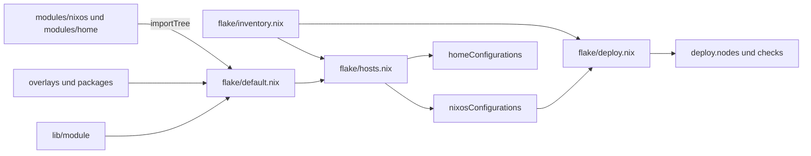

# Architektur

## Verzeichnisstruktur

```
.
├── flake.nix        # Inputs; delegiert die Outputs an ./flake
├── flake/           # flake-parts-Module und Inventar
│   ├── default.nix  # Kern: lib, Overlays, Modul-Import, Host-Konstruktoren
│   ├── inventory.nix# Liste der Hosts, Homes und Deploy-Ziele
│   ├── hosts.nix    # erzeugt nixosConfigurations und homeConfigurations
│   ├── deploy.nix   # erzeugt deploy.nodes und deploy-rs-Checks
│   ├── modules.nix  # exportiert nixosModules und homeManagerModules
│   ├── overlays.nix # exportiert overlays
│   └── packages.nix # exportiert packages und formatter
├── lib/module/      # Hilfsfunktionen, verfügbar als lib.awesome-flake
├── modules/nixos/   # NixOS-Module
├── modules/home/    # Home-Manager-Module
├── systems/         # Host-Konfigurationen, nach Architektur sortiert
├── homes/           # Home-Manager-Konfigurationen, nach Architektur sortiert
├── overlays/        # Nixpkgs-Overlays
├── packages/        # eigene Pakete
├── secrets/         # mit sops verschlüsselte Dateien
├── .sops.yaml       # Empfänger der Secrets
└── .forgejo/        # CI-Workflow
```

## Vom Flake zum Host

`flake.nix` definiert nur die Inputs. Die Outputs entstehen in `flake/` mit [flake-parts](https://flake.parts), unterstützte Systeme sind `x86_64-linux` und `aarch64-linux`.



Das Inventar `flake/inventory.nix` ist die zentrale Liste und enthält:

- `flakeRoot`: den absoluten Pfad des Repositories auf dem Desktop, den unter anderem `nh` und die Fish-Aliase nutzen
- `nixosConfigurations`: Hostname, System und Modulliste
- `homeConfigurations`: die eigenständige Home-Manager-Konfiguration
- `deployNodes`: die deploy-rs-Ziele und welche Konfiguration sie jeweils nutzen

Ein Deploy-Ziel ist also nicht dasselbe wie eine Konfiguration: `dns-1` und `dns-2` nutzen beide die Konfiguration `dns`, und `bodenheizung` hat gar kein Deploy-Ziel.

## Der Namespace `awesome-flake`

Alle eigenen Optionen, Hilfsfunktionen und Pakete liegen unter dem Namen `awesome-flake`. Module erhalten ihn als Argument `namespace`:

```nix
config.${namespace}.services.acme   # eigene Option
lib.${namespace}.mkBoolOpt          # eigene Hilfsfunktion
pkgs.${namespace}.ente-server       # eigenes Paket
```

Ein Host aktiviert Module deshalb in einem einzigen Block:

```nix
${namespace} = {
  services.forgejo = enabled;
  system.sops = enabled;
};
```

## Modulsystem

### Automatischer Import

`importTree` in `flake/default.nix` durchsucht `modules/nixos` und `modules/home` rekursiv. Jedes Verzeichnis mit einer `default.nix` wird zu einem Modul, und **jeder Host importiert alle Module**. Daraus folgt:

- Ein neues Modul muss nirgends eingetragen werden. Es muss nur eine `default.nix` in einem eigenen Verzeichnis haben und in Git erfasst sein.
- Alle Optionen existieren auf allen Hosts. Ob ein Modul wirkt, entscheidet allein sein `enable`.
- Andere `.nix`-Dateien im selben Verzeichnis, etwa `forgejo/kanidm.nix`, werden nicht automatisch geladen. Das Modul muss sie selbst per `imports` einbinden.

### Immer aktive Module

Diese Module haben kein `enable` und wirken deshalb auf jedem Host:

| Modul | Wirkung |
| --- | --- |
| `modules/nixos/user` | legt den Benutzer `philipp` mit Fish als Shell an |
| `modules/nixos/system/flakeRoot` | setzt die Option `flakeRoot` |
| `modules/nixos/programs/cli/neovim/*` (Untermodule) | setzen nvf-Einstellungen, die erst mit `cli.neovim` greifen |
| `modules/home/home` | setzt Benutzername, Home-Verzeichnis und `stateVersion` |

### Aufbau eines Moduls

Fast alle Module folgen diesem Muster:

```nix
{ config, lib, namespace, ... }:
with lib;
with lib.${namespace};
let
  cfg = config.${namespace}.services.beispiel;
in
{
  options.${namespace}.services.beispiel = {
    enable = mkBoolOpt false "Beispiel";
  };

  config = mkIf cfg.enable {
    # ...
  };
}
```

Module aktivieren ihre Abhängigkeiten selbst. Wer zum Beispiel `services.forgejo` einschaltet, bekommt `services.acme` automatisch dazu, und wer Secrets braucht, aktiviert `system.sops`. Darum sind auf einem Host oft mehr Module aktiv, als seine Datei unter `systems/` nennt.

### Web-Dienste

Web-Dienste folgen einer gemeinsamen Konvention:

- Der Dienst lauscht auf `127.0.0.1`, nginx terminiert TLS davor.
- Die Domain ist eine Option mit Standardwert unter `stahl.sh`.
- Viele Module haben eine Option `nginx.enable`, die standardmäßig an ist und auch die Ports 80 und 443 öffnet.
- Alle virtuellen Hosts nutzen das Wildcard-Zertifikat `stahl.sh` aus dem Modul `services.acme`.

## Hilfsfunktionen

`lib/module/default.nix` stellt diese Funktionen als `lib.awesome-flake` bereit:

| Funktion | Zweck |
| --- | --- |
| `mkOpt type default description` | Option mit Typ, Standardwert und Beschreibung |
| `mkOpt' type default` | wie `mkOpt`, ohne Beschreibung |
| `mkBoolOpt default description` | boolesche Option |
| `mkBoolOpt' default` | boolesche Option ohne Beschreibung |
| `mkEnabledOption description` | `enable`-Option, die standardmäßig `true` ist |
| `mkNginxProxyHost { proxyPass, ... }` | TLS-Reverse-Proxy-Host |
| `mkNginxStaticHost { root, ... }` | TLS-Host für statische Dateien |
| `mkSopsSecret dir file attrs` | Secret aus einer Datei im Secrets-Verzeichnis |
| `mkSopsDotenvSecret dir file` | dasselbe im Format `dotenv` |
| `enabled` / `disabled` | Kurzform für `{ enable = true; }` und `{ enable = false; }` |

Die beiden nginx-Funktionen setzen `forceSSL` und standardmäßig `useACMEHost = "stahl.sh"`. Der Parameter `location` wird in `locations."/"` übernommen, alle weiteren Attribute landen direkt im virtuellen Host.

## Flake-Inputs

| Input | Verwendung |
| --- | --- |
| `nixpkgs` | `nixos-unstable`, Basis aller Hosts |
| `flake-parts` | Struktur der Flake-Outputs |
| `deploy-rs` | Deployment und Checks |
| `home-manager` | Benutzerkonfiguration |
| `sops-nix` | Secrets |
| `nvf` | Neovim-Konfiguration |
| `plasma-manager` | deklarative KDE-Einstellungen |
| `firefox-addons` | Erweiterungen für LibreWolf |
| `hermes-agent` | KI-Agent, Home-Manager-Modul |
| `nixos-hardware`, `twitch-hls-client`, `zen-browser` | derzeit nicht aktiv genutzt, siehe [Offene Punkte](offene-punkte.md) |

`hermes-agent` folgt bewusst nicht dem eigenen `nixpkgs`: Es baut mit uv2nix gegen seinen eigenen Pin, und ein Überschreiben kann die Auswertung brechen.

## Overlays

Das Overlay `default` wird überall angewendet und setzt sich aus diesen Teilen zusammen:

| Overlay | Zweck |
| --- | --- |
| `packages` | stellt die Pakete aus `packages/` unter `pkgs.awesome-flake` bereit |
| `cinny` | baut `pkgs.awesome-flake.cinny` aus dem Cinny-Branch `dev` |
| `redlib-fixed` | ersetzt `pkgs.redlib` durch einen Fork mit festem Commit und überspringt zwei OAuth-Tests |
| `technitium-dns-server` | spiegelt das Paket nach `pkgs.awesome-flake` |
| `teamviewer-patchelf` | baut TeamViewer mit patchelf 0.15.2, weil mit 0.19.2 der Daemon beim Laden abstürzt |

Zusätzlich exportiert der Flake für jedes eigene Paket ein Einzel-Overlay `package/<name>`.

## Eigene Pakete

Die Pakete sind als `packages.<system>.<name>` und als `pkgs.awesome-flake.<name>` erreichbar.

| Paket | Version | Beschreibung | Genutzt von |
| --- | --- | --- | --- |
| `codeberg-themes` | `17-unstable-2026-11-06` | Codeberg-Themes und Logo für Forgejo | `services.forgejo` |
| `ente-server` | 4.4.25 | Backend von Ente Auth (`museum`) | `services.ente-server` |
| `ente-web-auth` | 4.4.25 | Web-Oberfläche von Ente Auth | `services.ente-auth` |
| `photocraft` | 0.3.0 | Bildbearbeitung mit Ebenen und PSD-Unterstützung | `apps.photocraft` |
| `linkwarden` | 2.11.3 | Lesezeichenverwaltung | kein Modul |
| `redlib` | `0.36.0-unstable-2026-04-07` | alternatives Reddit-Frontend | kein Modul |

Das Frontend `ente-web-auth` bekommt den API-Endpunkt schon beim Bauen. Eine Änderung von `services.ente-auth.apiEndpoint` löst deshalb einen neuen Build aus.

## Home-Manager

Home-Manager läuft auf zwei Wegen mit denselben Modulen:

- **Als NixOS-Modul:** `bodenheizung` bindet `homes/x86_64-linux/philipp@bodenheizung` über das Inventar ein. Das ist der normale Weg, denn `nh os switch` aktualisiert dabei auch die Benutzerumgebung.
- **Eigenständig:** als `homeConfigurations."philipp@bodenheizung"`.

Im NixOS-Betrieb nutzt Home-Manager die `pkgs` des Systems (`useGlobalPkgs`). Kollidierende Dateien werden mit der Endung `.bk-hm` gesichert.
